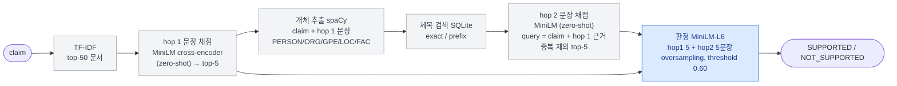
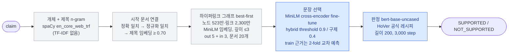

# 팀 베이스라인 4종 비교 분석

> 작성일: 2026-10-27
> 대상: 고준서 · 이상민 · 한기선 · 황혜림 베이스라인 (HoVer 기반 multi-hop 사실 검증)
> 근거: 각 폴더의 코드, 노트북 실행 출력, README·가이드 문서, git 기록
> 표기: 별도 표시가 없으면 성능 숫자는 **공식 dev 2-hop 1,126건** 기준이다. "추정"이라고 적은 값은 실측이 아니다.
> 출처: 성능 수치는 대부분 **각자 README·가이드·노트북 메모에 적힌 자기 보고값**이다. 노트북 출력으로 직접 확인된 것은 한기선 v3 수치와 황혜림 속도 벤치마크뿐이다. 같은 기준의 검증은 [7장](#7-최종-비교-전-해야-할-일)의 예측 jsonl 채점으로 한다.

---

## 목차

1. [요약](#1-요약)
2. [공통 프레임](#2-공통-프레임)
3. [팀원별 상세 분석](#3-팀원별-상세-분석)
   - [3.1 고준서](#31-고준서--학습-기반-k-hop-beam-search)
   - [3.2 이상민](#32-이상민--개체명-기반-explicit-2-hop)
   - [3.3 한기선](#33-한기선--학습된-hop-2-문서-검색기)
   - [3.4 황혜림](#34-황혜림--위키-하이퍼링크-그래프-탐색)
4. [단계별 차이 비교](#4-단계별-차이-비교)
5. [성능 비교와 해석](#5-성능-비교와-해석)
6. [비교 가능성 주의사항](#6-비교-가능성-주의사항)
7. [최종 비교 전 해야 할 일](#7-최종-비교-전-해야-할-일)
8. [고도화 방향](#8-고도화-방향)

---

## 1. 요약

| | 고준서 | 이상민 | 한기선 | 황혜림 |
|---|---|---|---|---|
| 핵심 아이디어 | 학습된 RoBERTa 4개 + **k-hop beam search** | **개체명(NER) → 제목 검색** + 사전학습 경량 Cross-Encoder | TF-IDF → 재정렬 + **학습된 hop-2 문서 검색기** | **위키 하이퍼링크 그래프** 탐색 (TF-IDF 없음) |
| 대상 hop | 2/3/4 (2-hop 먼저) | 2-hop | 2-hop | 2/3/4 |
| 학습한 모델 수 | 4 (전부 roberta-base) | 1 (판정기, MiniLM-L6) | 4 (전부 roberta-base) | 2 (문장 CE, BERT 판정기) |
| 평가셋 | 공식 dev (예정) | **train 내부 val 1,811건** | 공식 dev 2-hop 1,126건 | 공식 dev 4,000건 (hop별) |
| 현재 상태 | 코드 완성, GPU 학습 진행 중 | v6 완성, dev 미평가 | v2.2 완성, v3 실행 | 완성 |
| dev 2-hop 수치 | 없음 | 없음 | **acc 0.755 / HoVer(공식 규칙) 0.591** (가이드 기록) | acc 0.638 / HoVer 0.353 (README 기록) |
| 예측 jsonl 제출 | 없음 | 없음 (모델 가중치만 받음) | 없음 | 없음 |

- dev 2-hop 수치가 있는 것은 **한기선과 황혜림뿐**이고, 둘 다 자기 보고값이다. 황혜림 결과 파일(`data/results/`)은 `.gitignore`에 있어 저장소에 없다.
- 이상민은 평가셋이 다르고 분할 누수가 있어 수치를 그대로 비교할 수 없다.
- 고준서는 아직 학습 결과가 없다.

---

## 2. 공통 프레임

과제 요구사항은 "query에 관련된 hop을 탐색하고 이를 바탕으로 응답하는 구조"다. 네 베이스라인 모두 아래 4단계 pipeline을 따르며, 차이는 **각 단계를 무엇으로 채웠는가**에 있다.

```
claim → ① 1-hop 문서 후보 → ② 두 번째(bridge) 문서 탐색 → ③ 근거 문장 선택 → ④ SUPPORTED / NOT_SUPPORTED
```

HoVer 2-hop 실패의 대부분은 ②, 즉 claim에 이름이 직접 나오지 않는 두 번째 문서를 찾지 못하는 경우다. 한기선 분석에서 실패 claim의 85%가 "문서 하나는 찾고 나머지 하나를 놓친" 경우였다. 따라서 ②를 푸는 방식이 네 베이스라인의 가장 큰 차이다.

---

## 3. 팀원별 상세 분석

파이프라인 그림 색: **파란색 = HoVer train으로 학습한 단계**, 회색 = 학습 없음(규칙·검색·사전학습 모델 그대로).

### 3.1 고준서 — 학습 기반 k-hop beam search

위치: [고준서/e2e_v2/](../고준서/e2e_v2/)

#### 구조

코드: [retrieval.py](../고준서/e2e_v2/src/hover_e2e/retrieval.py) → [multihop.py](../고준서/e2e_v2/src/hover_e2e/multihop.py) → [evidence.py](../고준서/e2e_v2/src/hover_e2e/evidence.py) → [verifier.py](../고준서/e2e_v2/src/hover_e2e/verifier.py)

```mermaid
flowchart LR
    C([claim]) --> T["TF-IDF<br/>공식 top-100"]
    T --> R["문서 재정렬<br/>roberta-base<br/>hard negative 12개"]
    R --> S["상위 3개 문서<br/>= seed 경로"]
    S --> N["다음 hop 후보<br/>경로 본문·claim에 나온<br/>위키 제목 (약 500만)"]
    N --> B["경로 채점 RoBERTa<br/>(claim + 경로 문맥, 후보)<br/>0.7×이전 + log P, beam 5"]
    B -->|"목표 hop 수까지 반복<br/>(3/4-hop 공통 코드)"| N
    B --> E["문장 선택 RoBERTa<br/>top-5 문서, 문서당 ≤2"]
    E --> V["판정 roberta-base<br/>근거 5문장, 4 epoch"]
    V --> L([SUPPORTED / NOT_SUPPORTED])
    class R,B,E,V trained
    class T,S,N rule
    classDef trained fill:#dbeafe,stroke:#2563eb,color:#1e3a8a
    classDef rule fill:#f3f4f6,stroke:#9ca3af,color:#374151
```



#### 강점

- **누수 관리가 가장 엄격하다.**
  - `hpqa_id` 그룹 기준 분할
  - 공식 train/dev가 겹치는 77개 `hpqa_id` 그룹(train 422건)을 모든 학습에서 격리
  - dev 추론 함수는 타입 수준에서 label·`supporting_facts`를 받지 않음
- 정답 문장 번호 정합성 감사(CoreNLP UTF-16 offset 변환, 영향 claim 86건 분리), 설정 fingerprint 기반 체크포인트, pytest 21개.
- 네 명 중 유일하게 **3/4-hop까지 학습 모델로 일반화되는 설계**.

#### 약점과 리스크

- **실측 성능이 없다.** 노트북 출력 기준 00 preflight 완료, 01 retrieval(T4) 실행 시작, `02_multihop_2hop_fast`가 dev 100건 미리보기 단계. 발표(10/28)까지 4단계 학습을 모두 마치기 빠듯하다.
- 문서 본문을 최대 12,000자까지 붙이지만 `max_length=384`라 모델은 문서 앞부분만 본다.
- 판정기 입력이 5문장으로 고정. 한기선 실험에서는 val 기준 k=7~10이 더 좋았다. (제출 근거 수는 내부 val로 고르도록 되어 있음)

#### 성능

- 실측: TF-IDF 기준선만 있음 — 2-hop all-doc Hit@5 **39.7%**, Hit@100 **77.5%**
- **추정**: 구조가 한기선 v3에 beam과 경로 문맥을 더한 형태이므로 dev 2-hop acc 약 0.73~0.77, HoVer(공식 규칙) 약 0.55~0.63

---

### 3.2 이상민 — 개체명 기반 explicit 2-hop

위치: [이상민/](../이상민/) (v1 → v6)

#### 버전별 변화

| 버전 | 내용 | 내부 val 결과 |
|---|---|---|
| v1 | TF-IDF + Logistic Regression | acc 0.590 / macro-F1 0.493, 정답 문서 모두 찾음 24.8%, 정답 문장 모두 포함 16.0% |
| v2 | 사전학습 `ms-marco-MiniLM-L6` cross-encoder로 문장 재순위 | 기록 없음 |
| v3 | spaCy 개체 추출 → 제목 연결로 명시적 2-hop | 기록 없음 |
| v4 | 클래스 균형(oversampling) + threshold 탐색 | 기록 없음 |
| v5 | 제목 확장, hop별 top-5, oversampling | 최종 ckpt **acc 0.690 / macro-F1 0.633** (탐색 중 최고 0.713 / 0.651) |
| v6 | hop-2에서 hop-1과 겹치는 문장 제외 후 다음 후보로 보충 | 기록 없음 |

#### v6 구조 ([HoVer_v6_Training.ipynb](../이상민/v6/Colab/HoVer_v6_Training.ipynb))



#### 강점

- 문장 단위로 hop을 잇는 explicit 2-hop이라 **어떤 개체를 타고 넘어갔는지 설명 가능**하다.
- 모델이 작아 빠르고, 앱(FastAPI/iOS) 배포를 염두에 둔 구성.
- threshold, oversampling, 중복 제거 등 실험을 체계적으로 반복했다.

#### 약점

1. **평가 분할 누수.** train 2-hop을 `hpqa_id` 그룹 없이 무작위 80/20(stratified, seed 42)으로 나눴다. 같은 설정으로 재현하면 **val 1,811건 중 904건(49.9%)이 train과 같은 HotpotQA 질문에서 파생된 claim**이다. 같은 근거에 문장만 바꾼 SUPPORTED/NOT_SUPPORTED 쌍이 양쪽에 들어가므로 val 수치는 낙관적이다.
2. **라벨 분포 차이.** 내부 val은 SUPPORTED 72%, 공식 dev 2-hop은 46%. v5 val acc 0.690은 "전부 SUPPORTED"(0.718)보다 낮다. threshold 0.60도 이 분포에서 고른 값이라 dev에서는 다르게 동작한다.
3. **판정기 용량 부족.** MiniLM-L6은 6층·약 22M 파라미터이고 ms-marco(검색 관련성)로 사전학습되어 NLI 추론용이 아니다. 최대 10문장 입력을 1 epoch만 학습한다.
4. **HoVer score 계산이 공식 규칙과 다르다.** "앞 k+1개 문서, 문서당 2문장" 필터 없이 최대 10문장을 모두 인정하므로 공식 기준보다 높게 나온다.
5. **dev 평가 경로 없음.** 추론이 미리 계산된 train TF-IDF 파일에 있는 claim만 받는다. dev를 돌리려면 dev TF-IDF 파일 연결이 필요하다.

#### 성능

- 실측: 내부 val 기준만 있음 (위 표)
- **추정**(dev 2-hop, 공식 규칙): acc 약 0.62~0.68, HoVer 약 0.30~0.45

---

### 3.3 한기선 — 학습된 hop-2 문서 검색기

위치: [한기선/](../한기선/), 상세 가이드 [hover_2hop_baseline_guide.md](../한기선/docs/hover_2hop_baseline_guide.md)

#### 구조 (실행 순서 `02 → 05 → 08 → 06 → 07`)

```mermaid
flowchart LR
    C([claim]) --> T["TF-IDF<br/>후보 100개"]
    T --> R["05 문서 재정렬<br/>roberta-base"]
    R --> H1["top-2 문서<br/>= hop 1"]
    H1 --> N["hop 2 후보<br/>claim·hop 1 본문에 나온<br/>위키 제목 (약 480만)"]
    N --> B["08 hop 2 채점 RoBERTa<br/>(claim | hop 1, 후보)<br/>P(a) × P(c|a)"]
    B --> E["06 문장 선택 RoBERTa<br/>top-5 문서, 근거 10개"]
    E --> V["07 판정 roberta-base<br/>클래스 가중치<br/>검색 근거로 학습"]
    V --> L([SUPPORTED / NOT_SUPPORTED])
    class R,B,E,V trained
    class T,H1,N rule
    classDef trained fill:#dbeafe,stroke:#2563eb,color:#1e3a8a
    classDef rule fill:#f3f4f6,stroke:#9ca3af,color:#374151
```



#### 성능 (공식 dev 2-hop 1,126건)

v3 행은 노트북 출력으로 확인한 값이고, 나머지 행은 가이드 문서 기록값이다(노트북 출력은 v3 실행으로 덮어써짐).

| 버전 | 문서 all-hit@5 | acc | macro-F1 | HoVer(공식 규칙) | evidence_ok |
|---|---|---|---|---|---|
| claim-only (하한) | – | 0.622 | 0.620 | – | – |
| v1 단일 검색 | 57.7% | 0.737 | 0.736 | – | – |
| **v2.2 multi-hop** | 84.2% | **0.755** | **0.755** | **0.591** | 0.762 |
| v3 (10-27 노트북 출력) | **87.5%** | 0.729 | 0.728 | 0.579 | 0.766 |
| 정답 근거 입력 (상한) | – | 0.783~0.800 | 0.783~0.800 | – | – |

#### 강점

- 하한(claim-only)·상한(oracle)·단계별 천장을 모두 측정해 **병목 이동**을 근거로 보여준다. 병목이 검색에서 판정기로 옮겨왔다.
- `hpqa_id` 그룹 분할(train 8,166 / val 886), 제목 NFC/NFD 정규화 버그 발견과 수정 기록, 공식 규칙 채점기, k8s 데모.

#### 약점

- **v3에서 검색은 좋아졌는데(@5 84.2% → 87.5%) 판정은 0.755 → 0.729로 하락.** 기록된 재학습 편차(±0.01)보다 크다. 07 학습 로그에서 1 epoch 부근 loss가 0.68(≈ ln 2)에 머물다 회복하는데, 과거 "batch 16에서 loss가 ln 2에 고정돼 무너진" 증상과 비슷하다. seed를 바꿔 재확인이 필요하다.
- 오류가 NOT_SUPPORTED → SUPPORTED 방향에 몰려 있다. v3 기준 NS 605건 중 222건을 S로 예측(NS recall 63%). 비즈니스 핵심 지표("잘못된 답변을 놓치지 않는 비율")가 이것이다.
- 2-hop 전용 설계 (08이 hop 2까지만 다룸).
- 공식 train/dev 겹침 77개 그룹은 격리하지 않았다. 영향은 작겠지만 고준서 방식과 맞추는 것이 좋다.

---

### 3.4 황혜림 — 위키 하이퍼링크 그래프 탐색

위치: [황혜림/](../황혜림/), 상세 [README.md](../황혜림/README.md)

#### 구조



#### 성능 (공식 dev, README 기록값)

결과 파일과 평가 노트북 출력이 저장소에 없어 독립적으로 검증하지 못했다. 처리 시간은 `speed_benchmark.ipynb` 출력으로 확인했다.

| hop | n | 후보 20개 재현율 | 근거 문서 전부 찾음 | acc | macro-F1 | HoVer |
|---|---|---|---|---|---|---|
| 2 | 1,126 | 69.6 | 57.8 | 63.8 | 62.4 | 35.3 |
| 3 | 1,835 | 58.6 | 27.6 | 69.0 | 68.5 | 13.1 |
| 4 | 1,039 | 50.7 | 13.0 | 65.6 | 65.3 | 4.7 |
| 전체 | 4,000 | 59.6 | 32.3 | 66.7 | 66.4 | **17.2** |

- 공식 BERT+Retr: acc 73.7, HoVer 14.5 (논문 보고값)
- claim당 처리 시간 **151 ms** (같은 GPU에서 재현한 공식 구조 172 ms 대비 12% 빠름)

#### 강점

- **데이터 분석이 가장 깊다.** 2-hop 정답 문서 쌍의 87.4%가 직접 링크로 연결되어 있음을 확인하고 그 위에 설계했다.
- HotpotQA 덤프에 저장된 문장을 그대로 사용해 **문장 번호 정합성 문제가 원천적으로 없다.** (고준서가 CoreNLP 정렬 감사에 공들인 문제를 회피)
- 유일하게 **3/4-hop까지 실측**, 공식 논문 수치와 비교, 속도 벤치마크 보유.
- 트러블슈팅 기록(들어오는 링크 방향 문제, 탐색 예산 배분)이 구체적이다.

#### 약점

- **판정기가 claim-only 수준에 가깝다.** 2-hop acc 63.8%는 한기선 claim-only(62.2%)와 비슷하고, NS 정답률은 58.2%. 길이 200으로는 5문장이 다 들어가지 않을 수 있고, 3,000 step × 배치 8 ≈ 1.3 epoch로 학습량이 적다.
- 그래프 탐색이 학습되지 않아 2-hop 문서 재현율(57.8%)이 한기선(84.2%)보다 낮다.
- HoVer score에 "앞 k+1개 문서" 필터가 없어 공식 규칙보다 약간 높게 나올 수 있다.
- 공식 train/dev 겹침 그룹은 격리하지 않았다.

---

## 4. 단계별 차이 비교

| 단계 | 고준서 | 이상민 | 한기선 | 황혜림 |
|---|---|---|---|---|
| 1-hop 후보 | TF-IDF top-100 → RoBERTa | TF-IDF top-50 (재정렬 없음) | TF-IDF top-100 → RoBERTa | 개체 + 제목 연결 |
| bridge 탐색 원리 | 본문 속 제목 언급 | NER 개체 → 제목 검색 | 본문 속 제목 언급 | **실제 하이퍼링크** |
| bridge 채점 | **학습** RoBERTa, 경로 전체 문맥, beam | zero-shot MiniLM (문장 단위) | **학습** RoBERTa (claim + hop1) | zero-shot 임베딩 best-first |
| 문장 선택 | 학습 RoBERTa | zero-shot MiniLM | 학습 RoBERTa | 학습 MiniLM + hybrid threshold |
| 판정기 | roberta-base (125M) | MiniLM-L6 (22M) | roberta-base (125M) | bert-base (110M) |
| 불균형 처리 | macro-F1로 ckpt 선택 | oversampling + threshold | 클래스 가중치 | 없음 |
| 학습 데이터 | 전체 hop 17,749 | 2-hop 7,241 | 2-hop 8,166 | 전체 hop 18,171 |
| 분할 누수 관리 | ◎ 그룹 분할 + 겹침 격리 | ✗ 무작위 분할 | ○ 그룹 분할 | △ train/dev만 분리 |
| 문장 분리 | CoreNLP + 정합성 감사 | CoreNLP | CoreNLP | 덤프 원본 문장 |
| HoVer score 정의 | 공식 규칙 | 필터 없음 (≤10문장) | 공식 규칙 | k+1 필터 없음 (≤5문장) |

한 축 위에 놓으면:

- **multi-hop 방식**: 이상민(개체 기반, 규칙) → 황혜림(그래프 기반, 비지도) → 한기선(제목 언급 + 학습 scorer) → 고준서(한기선 방식을 k-hop beam으로 일반화)
- **학습량**: 이상민 < 황혜림 < 한기선 ≈ 고준서

---

## 5. 성능 비교와 해석

### dev 2-hop 1,126건 기준

기록값은 **굵게**, 나머지는 추정이다. 기록값도 같은 채점기로 검증하기 전에는 참고치다.

| | acc | macro-F1 | HoVer | 출처 |
|---|---|---|---|---|
| 한기선 v2.2 | **0.755** | **0.755** | **0.591** (공식 규칙) | 가이드 기록 |
| 한기선 v3 | **0.729** | **0.728** | **0.579** (공식 규칙) | 노트북 출력 |
| 황혜림 | **0.638** | **0.624** | **0.353** (k+1 필터 없음) | README 기록 |
| 고준서 (추정) | 0.73~0.77 | 0.73~0.77 | 0.55~0.63 |
| 이상민 (추정) | 0.62~0.68 | 0.60~0.66 | 0.30~0.45 |

### 해석

1. **검색 품질이 HoVer score를 결정한다.** HoVer score는 정답 문서마다 정답 문장을 찾아야 점수가 나므로, 검색을 학습한 한기선·고준서가 zero-shot 검색을 쓴 황혜림·이상민보다 크게 앞선다.
2. **acc는 판정기 용량과 학습량이 결정한다.** 황혜림은 근거를 상당히 찾는데도 acc가 claim-only 수준이다. 판정기가 근거를 활용하지 못하고 있다.
3. **한기선·고준서의 다음 병목은 판정기다.** 정답 근거를 넣어도 0.78~0.80이므로 roberta-base 판정기 자체의 천장이 낮다.
4. HoVer 리더보드(공식 baseline 15.32, Baleen 57.53)는 **2/3/4-hop 전체 test 기준**이라 2-hop만의 수치와 직접 비교하면 안 된다. 전체 hop 기준으로 비교 가능한 것은 현재 황혜림(17.2)뿐이다.

---

## 6. 비교 가능성 주의사항

| 항목 | 문제 | 영향 |
|---|---|---|
| 평가셋 | 이상민만 train 내부 val 사용 | 다른 세 명과 숫자 비교 불가 |
| 분할 누수 | 이상민 val의 49.9%가 train과 같은 `hpqa_id` | val 성능 과대 추정 |
| 라벨 분포 | train/val SUPPORTED 72%, dev 2-hop 46% | val에서 고른 threshold가 dev에서 다르게 동작 |
| HoVer 정의 | 이상민·황혜림은 공식 필터 미적용 | 공식 규칙보다 높게 나옴 |
| train/dev 겹침 | 공식 데이터 자체에 77개 `hpqa_id` 겹침 (고준서만 격리) | 다른 세 명의 dev 수치가 소폭 낙관적일 수 있음 |
| 재학습 편차 | 한기선 기록상 macro-F1 ±0.01, HoVer ±0.02 | 1~2%p 차이는 실행 간 편차일 수 있음 |

---

## 7. 최종 비교 전 해야 할 일

[공통/compare_baselines.py](compare_baselines.py)가 공식 규칙(앞 k+1개 문서, 문서당 앞 2문장)으로 dev 2-hop을 채점한다. 이 스크립트를 공식 비교 기준으로 쓴다.

| 담당 | 할 일 |
|---|---|
| 이상민 | dev TF-IDF 파일을 연결해 v6를 dev 2-hop 1,126건에 실행하고 jsonl로 내보내기. 스크립트 docstring 사용 예에 추가. 내부 val 수치는 최종 성능으로 쓰지 않기 |
| 황혜림 | `data/results/`의 dev 결과(`dev_<tag>.jsonl`, `.E.jsonl`, `.pred.jsonl`)에서 2-hop 1,126건을 예측 jsonl로 합쳐 제출 (README 수치 검증 겸 공식 규칙 재채점) |
| 고준서 | 시간이 부족하면 `02~05_2hop_fast` 노트북으로 2-hop만 완주 |
| 한기선 | v2.2와 v3 중 제출 버전 결정. v3 판정기 하락이 seed 문제인지 재확인. Drive의 `hover2_test_e2e_*.jsonl`을 예측 jsonl 형식으로 변환해 제출 |
| 공통 | 차이의 유의성을 주장하려면 `bootstrap_ci`를 paired bootstrap으로 변경 (스크립트 주석에 명시됨) |

예측 파일 형식(claim마다 한 줄, jsonl):

```json
{"uid": "...", "pred_label": "SUPPORTED", "docs": ["제목1", "제목2", "..."], "evidence": [["제목1", 0], ["제목2", 3]]}
```

실행:

```bash
python 공통/compare_baselines.py --gold hover_dev_release_v1.1.json \
    고준서=gojunseo.jsonl 이상민=leesangmin.jsonl 한기선=hangiseon.jsonl 황혜림=hwanghyerim.jsonl
```

---

## 8. 고도화 방향

1. **검색 후보 합치기**: 황혜림의 링크 그래프 이웃을 한기선·고준서의 hop-2 후보 pool에 추가. 2-hop 정답 문서 쌍의 87%가 직접 링크로 연결되어 있어 검색 천장이 올라갈 가능성이 높다.
2. **판정기 교체**: roberta-base → roberta-large 또는 MNLI로 사전학습된 DeBERTa-v3. 네 베이스라인 모두에서 판정기가 공통 병목이므로, 하나의 강한 판정기를 공통으로 쓰는 것이 효율적이다.
3. **NOT_SUPPORTED recall 개선**: 오류가 NS → S 방향에 몰려 있으므로 threshold를 val에서 NS recall 기준으로 조정하거나, NOT_SUPPORTED claim의 변형 유형(황혜림 `claim_mutations.py` 분석)을 활용한 hard negative 학습.
4. **3/4-hop 확장**: 고준서 beam 구조가 그대로 확장되므로, 2-hop 결과가 나오면 같은 모델로 3/4-hop을 추가 측정.
