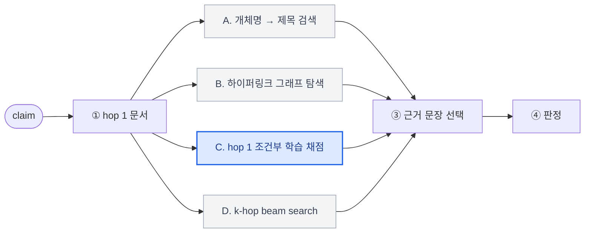
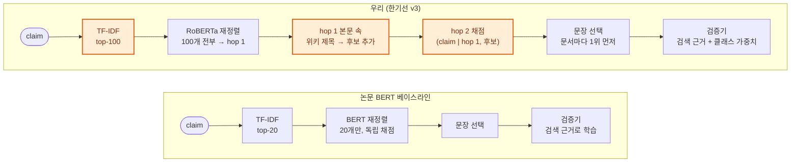
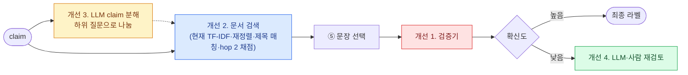

# 최종 발표 플로우 (10/28, 10분)

> 평가 기준: 공식 dev의 **2-hop 1,126건**을 test로 사용 (공식 test는 라벨 비공개)
> 대표 파이프라인: 한기선 v3 (학습된 hop-2 문서 검색기, 1차 후보 100개)
> 슬라이드: [Canva "HoVer 2-hop 검증"](https://www.canva.com/design/DAHZL_q3LPQ/GcljFc7wJshjdVA6TI7q8w/edit) (8장, 이 문서는 덱 기준으로 맞춤)
> 상세 근거와 질문 대비: [baseline_comparison.md](baseline_comparison.md), [한기선 가이드](../한기선/docs/hover_2hop_baseline_guide.md)

| # | 슬라이드 | 시간 |
|---|---|---|
| 1 | 주제와 해결하려는 문제 | 1분 |
| 2 | 과제와 데이터 | 1분 |
| 3 | 두 번째 문서를 찾는 4가지 접근 | 1분 |
| 4 | 평가 지표 | 1분 |
| 5 | 대표 파이프라인 구조 | 1.5분 |
| 6 | 핵심 아이디어와 결과 | 1.5분 |
| 7 | 논문과의 주요 차이 | 1.5분 |
| 8 | 이후 시도: 아키텍처 개선 | 1.5분 |

---

## 1. 주제와 해결하려는 문제

- **Fact Verification**: 주어진 문장이 사실인지, 외부 근거와 일치하는지 검증하는 작업
- **왜 필요한가**: LLM의 성능은 높아졌지만 할루시네이션은 여전히 발생 → 생성 결과를 검증하는 단계가 필수
- **왜 어려운가: multi-hop**: 정답을 판단하려면 여러 문서를 연결해야 하는 경우가 많고, 관련 정보가 여러 곳에 분산되어 있음
- 오른쪽 예시 그림:

```
Claim: The Assignation을 쓴 극작가는 1668년 계관시인이 되었다
  문서 1: The Assignation은 John Dryden이 쓴 희곡이다  ┐
  문서 2: John Dryden은 1668년 계관시인이 되었다      ┴→ 결론: 사실
→ 두 번째 문서(John Dryden)의 이름이 claim에 직접 등장하지 않음
```

## 2. 과제와 데이터

| 과제 | HoVer 데이터셋 | 우리 범위: 2-hop |
|---|---|---|
| 주어진 query와 관련된 사실을 2번의 hop 탐색으로 수집하고, 이를 바탕으로 claim을 검증하는 구조를 구축 (데이터: HoVer) | HotpotQA 기반 2~4-hop claim, 라벨 SUPPORTED / NOT_SUPPORTED, 코퍼스: 위키 첫 단락 약 **520만** 문서 | 공식 train 2-hop 9,052 → `hpqa_id` 그룹 분할 train **8,166** / val **886**, test **1,126** (= 공식 dev의 2-hop) |

데이터 분할 (공식 test는 라벨·정답 근거가 비공개라 직접 채점할 수 없음 → 공식 dev를 test로 사용):

```
HoVer 공식 데이터
├─ train 18,171건 ─▶ 2-hop 9,052건 ─▶ hpqa_id 그룹 분할 ─▶ train 8,166 / val 886
├─ dev    4,000건 ─▶ 2-hop 1,126건 ─▶ 우리 test
└─ test   claim만 공개 (라벨·근거 없음) ─▶ 사용 안 함
```

- val은 모델 선택용으로 train에서 떼어냄. 같은 HotpotQA 질문에서 나온 claim이 train과 val에 섞이지 않게 `hpqa_id` 단위로 분할
- 말로만: 공식 train과 dev에 같은 `hpqa_id`가 77개 그룹 겹친다. 학습에서 따로 빼지 않아 test 수치가 아주 약간 낙관적일 수 있음
- 주의: 클래스 불균형. train의 SUPPORTED 비율 **72%**, test **46%** → accuracy만으로는 성능을 판단할 수 없음

출처:
- HoVer: Jiang et al., "HoVer: A Dataset for Many-Hop Fact Extraction and Claim Verification", Findings of EMNLP 2020 (arXiv 2011.03088)
- HotpotQA: Yang et al., "HotpotQA: A Dataset for Diverse, Explainable Multi-hop Question Answering", EMNLP 2018 (arXiv 1809.09600)

## 3. 두 번째 문서를 찾는 4가지 접근

핵심 문제: 두 번째(bridge) 문서는 claim에 이름이 나오지 않는다 (1장 예시의 John Dryden). 공통 흐름은 같고, 팀은 ②를 푸는 방법을 네 가지로 나눠 시도했다.



| 접근 | ②를 푸는 원리 | 장점 | 한계 |
|---|---|---|---|
| A. 개체명 → 제목 검색 | claim·hop 1 문장의 개체(spaCy)를 위키 제목과 매칭 | 가볍고, 어떤 개체를 타고 넘어갔는지 설명 가능 | 규칙 기반이라 개체 추출이 틀리면 못 찾음 |
| B. 하이퍼링크 그래프 탐색 | 위키 링크 그래프를 임베딩 유사도로 best-first 탐색 | 2-hop 정답 문서 쌍의 87%가 직접 링크로 연결, 빠름 (claim당 151 ms)¹ | 탐색 채점을 학습하지 않아 문서 재현율이 낮음 |
| **C. hop 1 조건부 학습 채점** | hop 1 본문 속 위키 제목을 후보로, (claim, hop 1, 후보)를 RoBERTa로 채점 | **2-hop 문서 all-hit@5 87.5%로 가장 높음** | 2-hop 전용 |
| D. k-hop beam search | C를 경로 문맥 + beam으로 일반화, 목표 hop 수까지 반복 | 3·4-hop으로 그대로 확장 | 학습 비용이 크고 아직 실측 전 |

- 대표 파이프라인: **C** — 검색을 학습해 2-hop에서 가장 정확하다. 구조는 5장에서 설명
- 정리: A·B는 학습 없이 후보를 잇고, C·D는 hop 1을 조건으로 다음 문서를 고르는 법을 학습한다. D는 C의 3·4-hop 확장
- 말로만: A 이상민, B 황혜림, C 한기선, D 고준서. 상세는 [baseline_comparison.md 3장](baseline_comparison.md#3-팀원별-상세-분석)

출처: ¹ 황혜림 분석·속도 벤치마크 ([황혜림/README.md](../황혜림/README.md))

## 4. 평가 지표

| ① 검색 단계 | ② 판정 단계 | ③ 전체 평가 |
|---|---|---|
| 문서 all-hit@k: 정답 문서 2개가 **모두** 상위 k개 안에 든 claim 비율 | Accuracy, **Macro-F1**, **NOT_SUPPORTED recall** (사실이 아닌 claim을 놓치지 않는 비율) | **HoVer score**: 라벨이 맞고 근거도 맞았을 때만 정답 |

- 검색: 정답 문서 하나만 찾으면 0점. multi-hop의 핵심인 두 번째 문서까지 찾았는지 본다
- 판정: train SUPPORTED 72% / test 46%로 분포가 달라 accuracy만으로는 판단할 수 없다 → Macro-F1을 주 지표로, 서비스 관점에서는 NOT_SUPPORTED recall
- HoVer score (공식 규칙): 제출 근거 중 앞 k+1개 문서(2-hop은 3개), 문서마다 앞 2문장만 인정 → 정답 문서**마다** 정답 문장이 1개 이상 있으면 근거 정답(`evidence_ok`) → 라벨까지 맞아야 1점
- 왜 HoVer score인가: claim만 보고 판정해도 acc 62%가 나온다. 표현만 보고 우연히 맞힌 경우를 걸러 "올바른 근거로 맞혔는가"를 잰다

## 5. 대표 파이프라인 구조 (접근 C)

핵심: **hop 1을 단서로 hop 2를 찾는다** (hop 2 검색 블록을 강조)

```mermaid
flowchart LR
    C([claim]) --> T["① TF-IDF<br/>위키 520만 → 후보 100<br/>(저자 제공 목록)"]
    subgraph S1["문서 검색 (hop 1)"]
        T --> R["② RoBERTa 문서 재정렬<br/>후보 100개 전부 채점"]
        R --> H1["상위 2개 = hop 1"]
    end
    subgraph S2["hop 2 검색"]
        H1 --> N["③ 위키 제목 매칭<br/>hop 1 본문·claim 속 제목<br/>→ 후보 약 200개"]
        N --> B["④ RoBERTa hop 2 채점<br/>(claim | hop 1, 후보)"]
        B --> P["경로 점수<br/>P(hop 1) × P(hop 2 | hop 1)<br/>→ 문서 top-5"]
    end
    subgraph S3["근거·판정"]
        P --> E["⑤ RoBERTa 문장 선택<br/>약 20문장 → 근거 5개<br/>문서마다 1위 먼저"]
        E --> V["⑥ RoBERTa 검증기<br/>(claim, 근거 5문장)"]
    end
    V --> L([SUPPORTED / NOT_SUPPORTED])
    class R,B,E,V trained
    class T,H1,N,P rule
    classDef trained fill:#dbeafe,stroke:#2563eb,color:#1e3a8a
    classDef rule fill:#f3f4f6,stroke:#9ca3af,color:#374151
    style S2 stroke:#2563eb,stroke-width:2px,stroke-dasharray:5 5
```



- 예시 줄: 후보 문서 100개 → The Assignation ("… by John Dryden") → 링크 후보 John Dryden (claim에 없는 이름) → hop 2 문서 확정 → 근거 "… Poet Laureate in 1668" → SUPPORTED

### 왜 이 모델을 쓰나

| 단계 | 쓰는 것 | 이유 |
|---|---|---|
| ① | TF-IDF (HoVer 저자가 claim마다 미리 계산해 공개한 top-100 목록) | 520만 문서 전체에 신경망을 돌릴 수 없다. 빠르고 거친 검색으로 후보를 줄이고, ②가 그 100개를 **전부** 다시 채점해 순서를 매긴다 (retrieve-then-rerank). 학습은 claim당 20개, 추론만 100개 |
| ②④⑤⑥ | **RoBERTa-base 크로스 인코더** | claim과 문서(문장)를 한 입력으로 넣어 단어끼리 직접 비교하므로 가장 정확하다. 후보가 수십~수백 개로 줄어든 뒤라 비용을 감당할 수 있다 |
| 모델 크기 | roberta-base (125M) | 논문의 BERT-base와 구조는 같고 사전학습을 더 많이·오래 했다. Colab T4에서 네 모델을 모두 학습할 수 있는 크기 |
| ③ hop 2 후보 | 위키 제목 매칭 (규칙) | 사용한 위키 DB는 링크가 제거된 버전이라, 본문에 나온 위키 제목(약 480만)을 찾아 링크를 복원한다. 대문자로 시작하는 구간만 보면 후보가 1/3로 줄고 정답 포함률은 그대로 |

### 어떻게 파인튜닝했나

공통: 네 모델 모두 범용 `roberta-base`에서 각각 따로 출발, 분류층(2-클래스)은 새로 만들고 인코더 전체를 함께 학습. lr 2e-5, warmup 10%, batch 32, fp16

| 모델 | 배우는 질문 | 입력 | 학습 데이터 (train 8,166 claim) | 학습 |
|---|---|---|---|---|
| ② 문서 재정렬 | 이 문서가 근거 문서인가? | (claim, 제목. 본문) | claim당 TF-IDF 후보 20개, 양성 = 정답 문서 2개 (TF-IDF가 놓쳐도 넣음) → 약 16만 쌍 | 1 epoch |
| ④ hop 2 채점 | hop 1을 보고 나서, 이 후보가 나머지 근거 문서인가? | (claim \| hop 1 문서, 후보 문서) | 정답 문서 하나를 hop 1로 고정(teacher forcing), 양성 = 나머지 정답 문서, 음성 = hop 2 후보 중 7개. 두 정답을 번갈아 hop 1로 → 약 13만 쌍 | 1 epoch |
| ⑤ 문장 선택 | 이 문장이 근거 문장인가? | (claim, 제목. 문장) | 문서 5개의 모든 문장, 양성 = 정답 문장 → 약 16만 쌍 | 1 epoch |
| ⑥ 검증기 | claim이 맞는가? | (claim, 근거 5문장) | **⑤가 실제로 고른 근거**로 학습 (정답 근거 X), claim당 1개 → 8,166개 | 3 epoch, 클래스 가중치 (NS 1.77 / S 0.70), val macro-F1 최고 epoch 선택 |

- 검색 모델(②④⑤): 앞 단계가 정답을 놓쳐도 양성 예시를 보도록 정답을 일부러 넣는다. 예시가 13~16만 개라 1 epoch으로 충분하고, 점수는 순위로만 쓴다
- 검증기(⑥): 추론 때 받을 입력(잡음 섞인 검색 근거)과 같은 형태로 학습해야 하므로 정답을 넣지 않는다 (논문 Table 7과 같은 선택). train SUPPORTED 72% / test 46%라 클래스 가중치로 보정
- 슬라이드에는 다이어그램 + "왜 이 모델" 한 줄씩만, 파인튜닝 표는 질문 대비

출처:
- RoBERTa: Liu et al., "RoBERTa: A Robustly Optimized BERT Pretraining Approach", 2019 (arXiv 1907.11692)
- BERT: Devlin et al., "BERT: Pre-training of Deep Bidirectional Transformers for Language Understanding", NAACL 2019 (arXiv 1810.04805)
- HoVer 논문 Table 7, TF-IDF top-100 목록: Jiang et al., Findings of EMNLP 2020 (arXiv 2011.03088)
- 학습 설정·수치: [한기선 가이드 3.1.2절](../한기선/docs/hover_2hop_baseline_guide.md), v3 노트북 출력

## 6. 핵심 아이디어와 결과

test 2-hop 1,126건, 한기선 v3:

| 단계 | 지표 | 값 |
|---|---|---|
| ① 검색 | 문서 all-hit@5 — TF-IDF만 | 39.7% |
| | 문서 all-hit@5 — + RoBERTa 재정렬 (hop 1만) | 71.9% |
| | 문서 all-hit@5 — **+ hop 2 검색** | **87.5%** |
| ② 판정 | accuracy / **macro-F1** | 0.729 / **0.728** |
| | NOT_SUPPORTED recall | 0.633 (605건 중 383건) |
| ③ 전체 | evidence_ok (정답 문서마다 정답 문장 ≥1) | 0.766 |
| | **HoVer score (공식 규칙)** | **0.579** |

- 강조: hop 2 검색으로 문서 all-hit@5 **71.9% → 87.5%** (+15.6%p)
- HoVer score **0.579** = 근거 정답 0.766 중 라벨까지 맞힌 몫. 근거를 못 찾아 잃은 몫 23.4%p, 근거는 맞았는데 라벨이 틀린 몫 18.7%p
- 근거를 다 찾은 claim 798건의 acc 0.771, 놓친 328건 0.628 → 남은 병목은 판정기
- 오류는 NOT_SUPPORTED → SUPPORTED 쪽에 집중 (NS 605건 중 222건)

## 7. 논문과의 주요 차이

비교 대상: 한기선 파이프라인(v3) vs HoVer 논문 BERT 베이스라인 (arXiv 2011.03088v2). 주황색이 우리가 바꾼 부분



| | 논문 | 우리 (v3) | 효과 |
|---|---|---|---|
| ① 후보 범위 | TF-IDF top-20 안에서만 재정렬 (Appendix A) | **같은 TF-IDF 목록의 100개 전부 재정렬** (추론 비용 claim당 20 → 100회) | 검색 천장 60.2% → 77.5% |
| ② 두 번째 문서 | claim과 문서를 하나씩 독립 채점 → claim에 이름이 없는 문서는 단서가 없음 | **hop 1 본문 속 제목을 후보로 추가하고 hop 1을 조건으로 채점** | TF-IDF 밖 문서까지 찾아 천장을 넘음 |
| ③ 모델·학습 | BERT-base uncased, 2~4-hop 전체 | RoBERTa-base, 2-hop 전용, 클래스 가중치 | 분포 차이(train S 72% / test 46%) 보정 |
| 같은 점 | 검증기를 검색된 근거로 학습 | 같음 | 논문에서도 검색 근거 학습(acc 73.7) > 정답 근거 학습(67.6), Table 7 |

test 2-hop, 정답 문서 2개가 모두 잡힌 비율:

```
논문 방식의 천장   TF-IDF top-20 안에 둘 다     ████████████░░░░░░░░  60.2%
후보 확대 천장     TF-IDF top-100 안에 둘 다    ███████████████░░░░░  77.5%
우리 hop 1만       재정렬 후 top-5              ██████████████░░░░░░  71.9%
우리 hop 1 → 2     multi-hop 후 top-5           █████████████████░░░  87.5%  ← TF-IDF 천장을 넘음
```

- 강조: 논문 구조는 아무리 잘 재정렬해도 **60.2%**를 넘을 수 없다. 우리는 hop 2로 TF-IDF가 아예 못 찾은 문서까지 후보에 넣어 **87.5%**
- 말로만 덧붙일 주의: 논문 full pipeline acc 73.7, HoVer 14.5는 2~4-hop 4,000건 합산이고 hop별 값이 없다. hop 수에 따라 검색 난이도가 크게 달라서(논문 문서 EM 2-hop 30.1 / 3-hop 5.6 / 4-hop 0.6, Table 4) 우리 2-hop 값(acc 0.729)과 나란히 놓고 우열을 말하지 않는다

출처: Jiang et al., "HoVer: A Dataset for Many-Hop Fact Extraction and Claim Verification", Findings of EMNLP 2020 (arXiv 2011.03088v2)
- Appendix A (Experimental Setup): TF-IDF top-20 재정렬, BERT-base uncased, 학습 설정
- Table 4: hop별 문서 검색 EM
- Table 7: 검색 근거 학습 vs 정답 근거 학습, full pipeline acc·HoVer score

## 8. 이후 시도: 아키텍처 개선

현재 파이프라인에서 어느 단계를 바꾸는지:



| # | 개선 | 바꾸는 단계 | 근거 (v3 test) |
|---|---|---|---|
| 1 | NLI 사전학습 검증기 | ⑥ 검증기 | 근거를 다 찾은 claim도 acc 0.771, 정답 근거를 넣어도 0.783 |
| 2 | Dense multi-hop 검색 | ①~④ 문서 검색 | TF-IDF 천장 77.5%, 제목 매칭은 본문에 이름이 있어야 동작 |
| 3 | LLM claim 분해 | 검색 앞단 | bridge 개체를 명시적으로 찾고, 3·4-hop으로 확장 |
| 4 | 선택적 재검토 | 판정 뒤 | 오류가 NOT_SUPPORTED → SUPPORTED에 집중 (NS recall 63%) |

### 1. NLI 사전학습 검증기 (DeBERTa-v3-large¹)

- **무엇**: 검증기를 범용 `roberta-base`에서 출발하는 대신, MNLI 같은 자연어 추론(NLI) 데이터로 이미 학습된 DeBERTa-v3-large에서 출발해 HoVer로 파인튜닝
- **왜**: 지금 병목은 판정이다. 근거를 다 찾은 798건의 acc가 0.771이고, 정답 근거를 그대로 넣어도 0.783에 그친다. 근거는 맞았는데 라벨을 틀려 잃는 HoVer score가 18.7%p. NLI는 "전제가 가설을 뒷받침하나/반박하나"를 배우는 과제라 검증과 형태가 같다
- **기대**: NOT_SUPPORTED 판정(반박 신호 포착) 개선. DeBERTa는 같은 크기에서 RoBERTa보다 NLI 성능이 높다
- **비용**: 약 4.3억 파라미터(roberta-base의 3.5배). Colab T4에서는 fp16 + gradient accumulation 필요

### 2. Dense multi-hop 검색 (MDR², Baleen³)

- **무엇**: TF-IDF와 제목 매칭 대신, 문서를 벡터로 바꿔 두고 질의 벡터와 가까운 문서를 찾는 dense 검색을 hop마다 반복
  - MDR: hop 1을 찾은 뒤 (claim + hop 1 문서)를 새 질의로 다시 인코딩해 hop 2를 찾는다
  - Baleen: hop마다 찾은 문서에서 핵심 문장만 남겨(condense) 질의를 짧게 유지 → 3·4-hop에서도 질의가 길어지지 않는다. HoVer 리더보드 상위 방식
- **왜**: 지금 검색은 TF-IDF 목록(천장 77.5%)과 "hop 1 본문에 제목이 그대로 나와야" 하는 규칙에 묶여 있다. dense 검색은 단어가 달라도 의미로 찾고, 520만 문서 전체에서 hop 2를 직접 찾는다
- **비용**: 520만 문서 임베딩 색인(FAISS) 구축, 검색기 학습에 GPU 시간이 크게 든다

### 3. LLM claim 분해 (ProgramFC⁴)

- **무엇**: LLM이 claim을 단계별 하위 질문과 검증으로 이루어진 "프로그램"으로 바꾸고, 각 단계를 검색·답변·검증으로 실행
  ```
  claim: The Assignation을 쓴 극작가는 1668년 계관시인이 되었다
  Q1 = "The Assignation을 쓴 사람은?"          → John Dryden
  V1 = Verify("John Dryden은 1668년 계관시인이 되었다")
  ```
- **왜**: claim에 이름이 없는 bridge 개체(John Dryden)를 하위 질문의 답으로 **명시적으로** 꺼내 다음 검색에 쓴다. 판정 근거가 단계별로 남아 설명이 쉽고, hop 수가 늘어도 단계만 늘리면 된다
- **비용**: claim마다 LLM 호출 여러 번 → 느리고 비싸다. 학습 없이 few-shot으로 쓸 수 있다

### 4. 선택적 재검토

- **무엇**: 검증기 확률이 애매한 claim(예: 0.4~0.6)만 LLM이나 사람에게 넘기고, 나머지는 자동으로 판정
- **왜**: 오류가 NOT_SUPPORTED → SUPPORTED 방향(605건 중 222건)에 몰려 있다. 서비스에서는 틀린 주장을 통과시키는 비용이 크므로, 전부 다시 보지 않고 위험한 구간만 보는 것이 효율적이다
- **방법**: val에서 확신도 구간별 정확도를 재서 기준값을 정한다. 재검토 비율과 정확도의 trade-off를 곡선으로 보고 운영 지점을 고른다

출처:
1. He et al., "DeBERTaV3: Improving DeBERTa using ELECTRA-Style Pre-Training with Gradient-Disentangled Embedding Sharing", ICLR 2023 (arXiv 2111.09543)
2. Xiong et al., "Answering Complex Open-Domain Questions with Multi-Hop Dense Retrieval", ICLR 2021 (arXiv 2009.12756)
3. Khattab et al., "Baleen: Robust Multi-Hop Reasoning at Scale via Condensed Retrieval", NeurIPS 2021 (arXiv 2101.00436)
4. Pan et al., "Fact-Checking Complex Claims with Program-Guided Reasoning", ACL 2023 (arXiv 2305.12744)

---

## 발표 전 확인 (슬라이드 아님)

- [ ] 6·7장 수치는 v3 노트북 출력(10-27 실행) 기준. 공통 채점기로 `hover2_test_e2e_retrieved_mh.jsonl`을 채점한 값(all-hit@5 87.5% / acc 0.729 / macro-F1 0.728 / HoVer 공식 0.579)과 일치. seed 재실행으로 수치가 바뀌면 6·7·8장을 맞춘다
- [ ] 7장 슬라이드 하단에 출처 표기 (논문명, arXiv 2011.03088)
- [ ] Canva 6·7·8장도 v3 수치로 수정
- [ ] 데모를 넣을 경우 [한기선/demo](../한기선/demo/)
