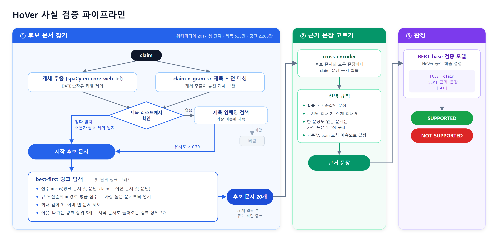
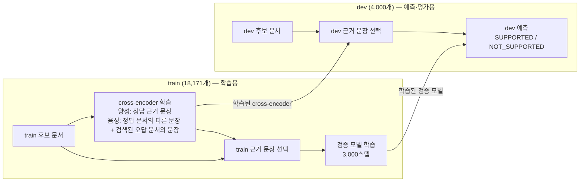

# hover-wiki-graph

[HoVer](https://hover-nlp.github.io/)(그리고 HotpotQA)가 사용한 2017-10-01 위키피디아 스냅숏 기준의
문서 제목 링크 그래프와, HoVer claim 분석 스크립트, 사실 검증 파이프라인 코드입니다.

필요한 것: [uv](https://docs.astral.sh/uv/)로 관리하는 Python 3.11–3.12(`uv sync`), `curl`, `bzip2`, `tar`.
모든 스크립트는 `uv run python ...`으로 실행합니다.

## 그래프

| 그래프 | 노드 | 엣지 | 출처 |
|---|---|---|---|
| 첫 단락 링크 (HoVer 검색 코퍼스) | 5,233,329 | 링크 등장 23,014,264건 | HotpotQA `withlinks-abstracts` 덤프 |
| 본문 전체 링크 | 5,486,204 | 고유 413,594,217개 | `enwiki-20171001-pagelinks.sql.gz` |

링크 대상은 2017-10-01 리다이렉트 표(7,991,447개)로 풀었습니다.
파일 형식과 재생성 명령은 [docs/graph.md](docs/graph.md)에 있습니다.
데이터는 커밋하지 않습니다. 다시 만드는 데 1시간 정도 걸리고, 작업 중 디스크가 최대 약 25GB 필요합니다.

### HoVer 근거 문서 연결 비율 (dev)

HoVer 근거 문서 제목 18,299개는 두 그래프 모두에 노드로 들어 있습니다.

| | 첫 단락 그래프 | 본문 전체 그래프 |
|---|---|---|
| 2-hop: 두 문서가 직접 링크로 연결 | 87.4% | 88.6% |
| 2-hop: 그 링크가 근거 문장에서 출발 | 80.3% | – |
| 3-hop: 근거 문서들이 서로 연결 | 65.4% | 68.7% |
| 4-hop: 근거 문서들이 서로 연결 | 37.2% | 47.2% |

## 스크립트

`scripts/`
- `fetch_ranges.sh` — 끊겨도 이어받는 병렬 구간 다운로드 (표준 출력으로 스트리밍)
- `download_abstracts.sh` — HotpotQA 첫 단락 덤프 다운로드
- `extract_pages.py` — pages-articles XML 덤프에서 ns0 문서·리다이렉트 표 추출
- `build_abstract_graph.py`, `build_full_graph.py` — 그래프 생성
- `validate_graph.py` — HoVer 근거 문서 연결 비율 보고
- `title_utils.py` — 제목 정규화, HTML 엔티티 처리, 리다이렉트 해석
- `make_colab_bundle.py` — 노드·링크·HoVer json을 Colab용 `data/colab_bundle/`로 묶기
- `jscompat.py` — JavaScript와 같은 숫자 포맷·키 순서·JSON 출력 (Node.js에서 옮긴 스크립트들이
  기존 출력과 바이트 단위로 같게 나오도록 함)

`scripts/analysis/` (입력: `hover_{train,dev,test}_release_v1.1.json`이 있는 폴더)
- `dataset_stats.py <data_dir>` — 라벨·hop 분포, 근거 문장·제목 통계
- `claim_mutations.py <data_dir>` — NOT_SUPPORTED claim이 짝이 되는 SUPPORTED claim과 어떻게 다른지
- `claim_logic.py <data_dir> <split> [ex]` — 규칙 기반 claim 논리 구조 분류
- `hop2_structure.py <data_dir> <split> [ex]` — 2-hop claim 세부 구조 분류

분석용 분류기는 정규식 휴리스틱이라 비율은 대략적인 경향으로 봐 주세요.

## 사실 검증 파이프라인

### claim 하나가 판정되기까지



원본 벡터 이미지: [docs/pipeline.svg](docs/pipeline.svg)

### train과 dev의 쓰임



1. **후보 문서 찾기**: claim에서 개체(spaCy `en_core_web_trf`)와 제목 사전에 있는 n-gram을 뽑아
   제목에 연결합니다(정확 일치 → 소문자·괄호 제거 일치 → 제목 임베딩 검색). 연결된 문서에서 시작해
   첫 단락 링크 그래프를 best-first로 탐색하고, 20개 문서를 엽니다.
2. **근거 문장 고르기**: HoVer train으로 학습한 cross-encoder(정답 근거 문장 vs. 검색된 오답 문서의 문장)로
   후보 문서의 모든 문장에 점수를 매깁니다. 고르는 규칙은 두 가지입니다.
   - `fixed`: 문서마다 상위 2문장, 전체 상위 5문장 (지금까지의 결과)
   - `hybrid`: 근거일 확률이 기준값 이상인 문장(문서당 최대 2, 전체 최대 5) + 아직 한 문장도 안 뽑힌 문서는
     가장 높은 문장 1개를 낮은 기준값으로 구제. 기준값은 train 교차 예측 점수로 고릅니다(`retrieval/tune_selection.py`).

   train 근거는 2-fold 교차 예측으로 만듭니다. 한쪽 절반으로 학습한 cross-encoder가 다른 절반의 점수를 매겨서,
   판정 모델이 dev와 같은 조건의 근거로 학습하게 합니다.
3. **판정**: HoVer 공식 레시피(bert-base-uncased, 최대 길이 200, claim ≤ 60토큰, 학습률 3e-5,
   배치 4 × 2, 3,000스텝)로 train에서 고른 근거 문장을 넣어 학습한 모델이 SUPPORTED / NOT_SUPPORTED를 판정합니다.

### 실행 방법

GPU가 필요한 단계라 Colab 노트북으로 돌립니다.

| 노트북 | 하는 일 |
|---|---|
| [colab/hover_retrieval.ipynb](colab/hover_retrieval.ipynb) | 1단계. 설정 셀의 `SPLIT`을 `dev`, `train`으로 바꿔 두 번 실행 |
| [colab/hover_evidence_verify.ipynb](colab/hover_evidence_verify.ipynb) | 2·3단계와 dev 평가 |
| [colab/speed_benchmark.ipynb](colab/speed_benchmark.ipynb) | 공식 베이스라인 재현과의 속도 비교 |

필요한 파일은 Google Drive `MyDrive/hover_bundle/`에 둡니다. `scripts/make_colab_bundle.py`가 만드는
노드·링크·HoVer json과, `retrieval/export_sentences.py`가 만드는 첫 단락 문장 `sents.jsonl.gz`입니다.
결과는 `hover_bundle/results/`, 학습한 모델은 `hover_bundle/models/<검색 설정>/`에 저장됩니다.
첫 실행 때 첫 단락 텍스트·제목/첫 문단 임베딩·문장 저장소를 `hover_bundle/cache/`(약 12GB)에 저장하고,
다음 실행부터는 다시 계산하지 않고 불러옵니다.

2·3단계는 `retrieval/` 스크립트이므로 노트북 없이 직접 실행할 수도 있습니다. `retrieval/build_store.py`로
문장 저장소를 만들고 1단계 결과를 `data/results/`에 둔 뒤 실행합니다. 데이터 폴더는 환경변수 `HOVER_DATA`로 바꿀 수 있습니다.
```
cd retrieval
T=B20_M5_d3_both_in3d0_floor0.7; R=../data/results
# cross-encoder: 전체 1개(dev용) + fold 2개(train 교차 예측용)
uv run python sentence_selector.py train --retrieval $R/train_$T.jsonl --out ../data/models/$T/sentence_selector
uv run python sentence_selector.py train --retrieval $R/train_$T.jsonl --folds 2 --exclude-fold 0 --out ../data/models/$T/ce_f0
uv run python sentence_selector.py train --retrieval $R/train_$T.jsonl --folds 2 --exclude-fold 1 --out ../data/models/$T/ce_f1
# 후보 문장 점수 (train은 fold별, 합쳐서 하나로)
uv run python sentence_selector.py score --retrieval $R/train_$T.jsonl --out ../data/models/$T/ce_f0 --folds 2 --only-fold 0 --output f0.jsonl
uv run python sentence_selector.py score --retrieval $R/train_$T.jsonl --out ../data/models/$T/ce_f1 --folds 2 --only-fold 1 --output f1.jsonl
cat f0.jsonl f1.jsonl > $R/train_$T.oof2.scores.jsonl
uv run python sentence_selector.py score --retrieval $R/dev_$T.jsonl --out ../data/models/$T/sentence_selector --output $R/dev_$T.scores.jsonl
# 기준값 고르기 (train) → 규칙 적용 (예: thr 0.5, doc-thr 0.2)
uv run python tune_selection.py --scores $R/train_$T.oof2.scores.jsonl
uv run python sentence_selector.py apply --scores $R/train_$T.oof2.scores.jsonl --rule hybrid --thr 0.5 --doc-thr 0.2 --output $R/train_$T.E.jsonl
uv run python sentence_selector.py apply --scores $R/dev_$T.scores.jsonl --rule hybrid --thr 0.5 --doc-thr 0.2 --output $R/dev_$T.E.jsonl
# 판정 모델 학습·예측·평가
uv run python verifier.py train   --evidence $R/train_$T.E.jsonl --out ../data/models/$T/verifier_E
uv run python verifier.py predict --evidence $R/dev_$T.E.jsonl --out ../data/models/$T/verifier_E
uv run python evaluate.py --tag $T --evidence-tag E
```
`sentence_selector.py select`는 점수 매기기와 규칙 적용을 한 번에 합니다(기본 `fixed`).

## HoVer 공식 베이스라인과의 차이

공식 베이스라인은 HoVer 논문([Jiang et al., 2020](https://arxiv.org/abs/2011.03088))과
[hover-nlp/hover](https://github.com/hover-nlp/hover) 저장소 기준입니다. 위키 코퍼스(2017-10-01 HotpotQA 첫 단락)는 같습니다.

| 단계 | HoVer 공식 베이스라인 | 이 파이프라인 |
|---|---|---|
| 문서 후보 생성 | TF-IDF(DrQA, bi-gram)로 문서 검색 | claim 개체(spaCy `en_core_web_trf`, DATE·숫자류 제외) + n-gram 제목 매칭 → 제목 연결(정확 일치 → 소문자·괄호 제거 일치 → 제목 임베딩, 유사도 0.70 미만은 버림) |
| 문서 선택 | TF-IDF 상위 20개를 BERT-base로 재순위 → 상위 5개 문서 | 시작 문서에서 첫 단락 링크 그래프를 best-first 탐색 (MiniLM 임베딩, 최대 깊이 3, 나가는 링크 상위 5개 + 들어오는 링크 상위 3개를 따로 선택) → 20개 문서 |
| 문서 간 연결 | 쓰지 않음 (문서를 독립적으로 점수화) | 위키 하이퍼링크를 따라 숨은 중간 개체(bridge) 문서로 이동 |
| 문장 분리 | Stanford CoreNLP로 실행 시 분리 | HotpotQA 덤프에 저장된 문장 그대로 (HoVer 문장 번호와 일치) |
| 근거 문장 선택 | BERT-base. 상위 5개 문서를 문서마다 한 번씩 읽고(claim + 첫 단락 전체), 문서당 최대 7문장의 확률을 내서 0.5를 넘는 문장을 모두 선택 (개수 가변) | cross-encoder(`ms-marco-MiniLM-L-6-v2`에서 시작해 HoVer train으로 미세조정, 검색된 오답 문서의 문장을 음성으로 사용), 문서마다 상위 2문장, 전체 5문장 고정 (문장을 하나씩 따로 판단) |
| 검증 모델 | BERT-base-uncased, 길이 200, claim ≤ 60토큰, 학습률 3e-5, 배치 4 × 2, 3,000스텝 | 같은 레시피 |
| 검증 모델 학습 입력 | BERT+Retr: 파이프라인이 고른 근거 / BERT+Gold: 정답 근거 | 파이프라인이 고른 train 근거 (BERT+Retr 방식) |

## 성능 평가 (dev 4,000개)

현재 설정 기준입니다: 시작 문서에서 들어오는 링크도 따라가는 그래프 탐색(결과 태그 `B20_M5_d3_both_in3d0_floor0.7`)
+ 근거 문장 hybrid 규칙 + train 교차 예측 근거로 학습한 검증 모델.

### 최종 결과 비교

| 시스템 | Accuracy | F1 (macro) | HoVer score | claim당 처리 시간 |
|---|---|---|---|---|
| **이 파이프라인** | 66.7 | 66.4 | **17.2** | **151 ms** |
| 공식 BERT+Retr (검색 근거로 학습) | **73.7** | – | 14.5 | 172 ms* |
| 공식 BERT+Gold (정답 근거로 학습) | 67.6 | – | 14.9 | 172 ms* |
| 공식 claim만 보고 판정 (근거 없음) | 63.7 | – | – | – |
| 공식, 정답 근거를 넣었을 때 (상한) | 81.2 | – | – | – |

HoVer score는 논문 정의를 그대로 따릅니다. 라벨이 맞고, 동시에 정답 근거 문서마다 근거 문장을
하나 이상 찾았을 때만 맞힌 것으로 칩니다. 공식 수치는 논문 Table 6·7(dev)이고, 논문은 판정 F1을 보고하지 않습니다.
\*처리 시간은 논문에 없어 같은 GPU(Colab L4)에서 공식 구조를 재현해 잰 값입니다(아래 [속도 비교](#속도-비교)). 두 공식 모델은
학습 데이터만 다르고 실행 과정이 같아 시간이 같습니다.

### 단계별 결과 (%)

| hop | n | 시작 문서 재현율 | 후보 20개 재현율 | 근거 문서 전부 찾음 | 근거 문장 정밀도 | 근거 문장 재현율 | 근거 문장 F1 | Accuracy | F1 (macro) | HoVer score |
|---|---|---|---|---|---|---|---|---|---|---|
| 2 | 1,126 | 52.1 | 69.6 | 57.8 | 44.5 | 56.3 | 46.5 | 63.8 | 62.4 | 35.3 |
| 3 | 1,835 | 43.0 | 58.6 | 27.6 | 43.1 | 46.1 | 42.0 | 69.0 | 68.5 | 13.1 |
| 4 | 1,039 | 39.6 | 50.7 | 13.0 | 44.6 | 39.2 | 39.5 | 65.6 | 65.3 | 4.7 |
| 전체 | 4,000 | 44.7 | 59.6 | 32.3 | 43.9 | 47.2 | 42.6 | 66.7 | 66.4 | 17.2 |

- 재현율은 claim마다 정답 근거 문서(또는 문장) 중 찾은 비율의 평균입니다.
- 근거 문장 F1은 claim마다 정답 근거 문장 집합과 선택 문장 집합의 F1을 낸 뒤 평균한 값입니다.
  논문의 공식 문장 선택 F1은 hop별 57.2 / 49.8 / 45.0, 전체 50.6입니다(Table 5).
- 논문의 문서 검색 결과는 상위 5개 문서의 EM/F1이라(Table 4), 위 표의 재현율과 바로 비교할 수 없습니다.

### hop별 정확도 비교

| hop | 이 파이프라인 | 공식 claim만 (근거 없음) | 차이 | 공식, 정답 근거 (상한) |
|---|---|---|---|---|
| 2 | 63.8 | 57.5 | +6.3 | 79.8 |
| 3 | 69.0 | 67.7 | +1.3 | 83.5 |
| 4 | 65.6 | 63.6 | +2.0 | 78.6 |
| 전체 | 66.7 | 63.7 | +3.0 | 81.2 |

### 해석

1. **근거 문장은 공식보다 잘 찾습니다.** HoVer score가 17.2로 공식(14.5~14.9)보다 높습니다.
   특히 2-hop은 정답 근거 문서를 전부 찾는 비율이 57.8%입니다.
2. **판정 정확도는 공식보다 7%p 낮고, claim만 보고 판정한 수준(63.7)보다 3%p 높습니다.**
   3·4-hop은 claim만 쓴 결과보다 1~2%p 높을 뿐이라, 검증 모델이 근거보다 claim 문장 자체의 패턴에 기대고 있습니다.
   SUPPORTED 쪽으로도 치우쳐 있습니다(정답이 NOT_SUPPORTED인 claim의 정답률 58.2%).
3. **가장 큰 병목은 후보 문서 검색입니다.** 개체로 찾은 시작 문서가 정답 문서의 44.7%만 포함하고,
   그래프 탐색으로 15%p를 더 찾습니다. 정답 근거 문서를 전부 찾은 claim은 3-hop 27.6%, 4-hop 13.0%뿐입니다.

### 근거 문장 선택 규칙 비교 (dev)

근거 문장을 항상 5개 고르던 규칙(`fixed`)을, 근거일 확률이 높은 문장만 고르는 규칙(`hybrid`)으로 바꿨습니다.
기준값은 train 교차 예측 점수로 골랐고(정답 문서 커버 하락 1%p 이내에서 근거 F1 최대),
결과는 **확률 0.9 이상 문장 + 한 문장도 없는 문서는 확률 0.4 이상인 최고 문장 1개**입니다. 평균 근거 문장은 5개에서 3.6개로 줄었습니다.

| (%) | fixed | hybrid (현재) |
|---|---|---|
| 근거 문장 정밀도 | 32.5 | **43.9** |
| 근거 문장 재현율 | **50.9** | 47.2 |
| 근거 문장 F1 | 38.8 | **42.6** |
| 정답 문서마다 근거 문장이 하나 이상 있음 | **26.2** | 25.2 |
| Accuracy | 65.5 | **66.7** |
| F1 (macro) | 65.4 | **66.4** |
| HoVer score | **17.5** | 17.2 |

- 근거가 깔끔해져(정밀도 +11.4%p) 근거 문장 F1과 정확도가 올랐습니다(4-hop 정확도 +2.6%p).
- 근거를 줄인 만큼 정답 문서 커버가 1%p 떨어져 HoVer score는 거의 그대로입니다.
- hybrid 쪽은 train 근거도 2-fold 교차 예측으로 만든 실행이라, 두 변화의 효과를 따로 나눠 보지는 않았습니다.

### 주의할 점

- 공식 수치는 논문 보고값이고, 이 저장소에서 공식 코드를 다시 돌린 결과가 아닙니다.
- 시드 하나로 학습한 결과라 1%p 안팎의 정확도 차이는 실행 간 편차일 수 있습니다. HoVer score와 근거 커버는
  검색 결과로 거의 정해져 더 믿을 만합니다.

## 속도 비교

같은 GPU(Colab L4)에서 dev claim 290개를 하나씩(배치 1) 처리한 claim당 평균 시간입니다(ms).
이 파이프라인은 위 성능 평가와 같은 현재 설정이고, HoVer 공식은 논문·저장소 구조를 재현했습니다
([colab/speed_benchmark.ipynb](colab/speed_benchmark.ipynb)).

| 단계 | 이 파이프라인 | HoVer 공식 |
|---|---|---|
| 문서 찾기 | 110.1 | 128.2 |
| └ 개체 추출 + n-gram | 15.9 | – |
| └ 시작 문서 연결 | 20.7 | – |
| └ 링크 그래프 탐색 (20개) | 73.5 | – |
| └ TF-IDF 상위 100 | – | 34.3 |
| └ BERT 재순위 (20개 문서) | – | 93.9 |
| 근거 문장 선택 | 30.3 | 33.4 |
| 판정 (BERT-base) | 10.7 | 10.1 |
| **합계** | **151.1** | **171.8** |

- claim당 처리 시간은 이 파이프라인이 약 12% 짧습니다. 공식은 문서 20개를 BERT-base로 하나씩 재순위하는
  단계가 가장 무겁고, 이 파이프라인은 문서를 열 때마다 "claim + 문서"를 임베딩하는 그래프 탐색이 가장 무겁습니다.
- 공식 재현에서 실행 중 Stanford CoreNLP 문장 분리는 빠져 있어 공식 쪽 시간은 실제보다 짧게 나온 값입니다.
  TF-IDF는 sklearn 해싱(단어+두 단어 묶음, log TF × IDF)으로 재현했고, 재순위·문장 선택 BERT는 학습되지 않은
  가중치지만 계산량이 같아 시간에는 영향이 없습니다.

## 트러블슈팅

### 1. 나가는 링크만 따라가면 2-hop의 숨은 문서에 닿지 못함

처음에는 문서에서 **나가는** 링크만 따라갔습니다(결과 태그 `B20_M5_d3_out_floor0.7`). 2-hop에서 시작 문서가
정답 문서 2개 중 1개만 잡은 claim 519개를 보니, 22%(116개)는 숨은 문서가 시작 문서를 **가리키기만** 해서
링크 방향 때문에 탐색이 닿을 수 없었고, 그중 6%만 찾았습니다.

- 2-hop 정답 문서를 모두 찾은 비율 52.5%, 2-hop HoVer score 35.0
- (전체 Accuracy 66.6, HoVer score 18.8)

→ 문서로 **들어오는** 링크도 따라가도록 바꿨습니다.

### 2. 들어오는 링크를 모든 깊이에서 따라가면 3·4-hop이 나빠짐

문서를 열 때마다 들어오는 링크 상위 3개를 추가했더니(`both_in3`), 큐에 쌓이는 후보가 늘어
20개 열람 예산을 그쪽에 쓰는 바람에 깊은 경로를 덜 열었습니다.

| (%) | 나가는 링크만 | 모든 깊이에서 들어오는 링크 |
|---|---|---|
| 후보 20개 재현율 2 / 3 / 4-hop | 65.2 / 58.5 / 49.5 | 68.0 / 55.4 / 47.2 |
| HoVer score | 18.8 | 15.8 |

→ 들어오는 링크는 **시작 문서에서만** 따라가도록 바꿨습니다(`IN_MAX_DEPTH = 0`, 현재 설정).
2-hop 정답 문서를 모두 찾는 비율이 52.5% → 57.8%로 올랐습니다. 다만 3-hop 근거 커버는 22.7% → 19.7%로 아직
처음 설정보다 낮아, 시작 문서의 들어오는 링크 수를 줄이거나 예산을 늘리는 조정이 남아 있습니다.

## 데이터

HoVer 데이터: <https://hover-nlp.github.io/> (CC BY-SA 4.0). 위키피디아 본문은 CC BY-SA입니다.
